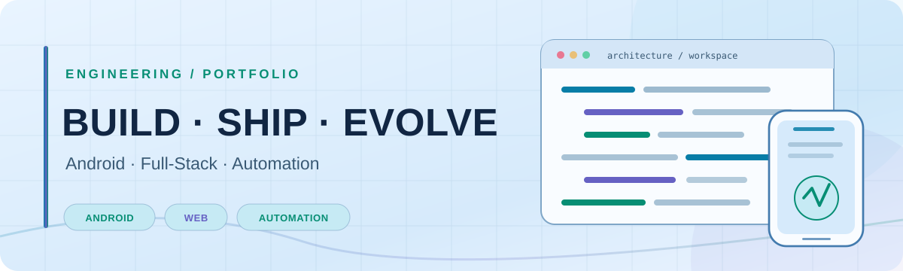

# Latan Villegas

**Ingeniería de software · Android · Web · Automatización**

Desarrollo productos móviles y web con foco en **arquitectura mantenible, rendimiento, accesibilidad y experiencia de usuario**.

[Proyectos](#proyectos-destacados) · [Tecnologías](#tecnologías-y-prácticas) · [Contacto](#contacto)

## Sobre mí

Trabajo en aplicaciones Android, plataformas web y herramientas de automatización. Me interesa transformar necesidades reales en soluciones comprensibles, reproducibles y fáciles de mantener.

Mis proyectos públicos reflejan trabajo con interfaces móviles, reproducción multimedia, aplicaciones web progresivas y flujos de generación automatizada.

## Proyectos destacados

| Proyecto | Stack principal | Descripción |
| --- | --- | --- |
| **[OpenRadio](https://github.com/latanvillegas/Radio-Escucha)** | Kotlin · Jetpack Compose · Media3 · Room | Radio por Internet para Android con reproducción en segundo plano, favoritos y controles multimedia. [Versiones](https://github.com/latanvillegas/Radio-Escucha/releases/latest). |
| **[Radio Satelital](https://github.com/latanvillegas/Radio_Satelital)** | Next.js · React · TypeScript · PWA | Plataforma de emisoras en vivo con interfaz adaptable y herramientas de cabina de estudio. |
| **[FUTO Keyboard Themes](https://github.com/latanvillegas/futo-keyboard-themes)** | Python · GitHub Actions | Temas de teclado con generación automatizada de paquetes ZIP. [Descargas](https://github.com/latanvillegas/futo-keyboard-themes/releases/latest). |
| **[Biblia Viva](https://github.com/latanvillegas/biblia-viva)** | React Native · Expo · TypeScript | Aplicación de lectura y estudio bíblico; **MVP en desarrollo**. |

Las características, versiones y requisitos de cada proyecto se documentan en su propio repositorio.

## Tecnologías y prácticas

| Área | Tecnologías y herramientas |
| --- | --- |
| **Android** | Kotlin, Jetpack Compose, Media3, Android Studio |
| **Web y móvil multiplataforma** | TypeScript, React, Next.js, React Native, Expo, PWA |
| **Automatización** | Python, GitHub Actions, Git |
| **Diseño y colaboración** | Figma, documentación técnica y control de versiones |

**Criterios de trabajo:** separación de responsabilidades, automatización reproducible, interfaces accesibles, documentación mantenible y revisión continua de calidad.

## Contacto

- **GitHub:** [@latanvillegas](https://github.com/latanvillegas)
- **Correo:** [alv.oficial123@gmail.com](mailto:alv.oficial123@gmail.com)

También desarrollo proyectos de producción musical bajo el nombre **morac**: [canal de YouTube](https://youtube.com/channel/UCn6V2K-aCDw_defqIb0OC1A).

---

Este perfil prioriza información verificable sobre estadísticas decorativas. Las novedades y versiones se consultan desde los repositorios enlazados.
