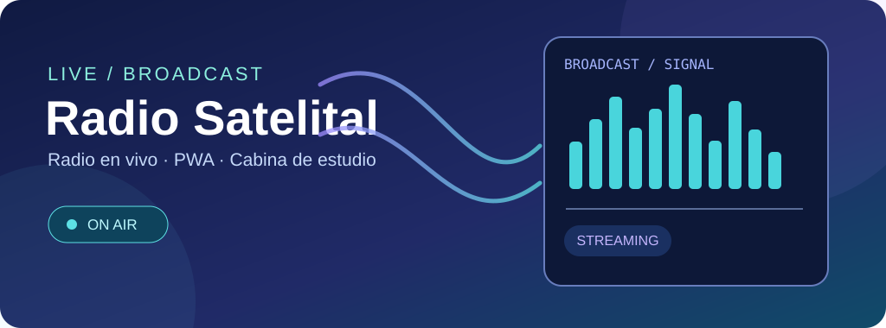

<picture>
  <source media="(prefers-color-scheme: dark)" srcset="assets/banner-dark.svg">
  <source media="(prefers-color-scheme: light)" srcset="assets/banner.svg">
  
</picture>

<h1>Hola, soy Latan Villegas</h1>

<strong>Android Developer · Full-Stack Builder · Automation</strong>

Transformo ideas en productos móviles y web con <strong>arquitectura mantenible, rendimiento y experiencias cuidadas</strong>.

  
  
  

  <a href="#proyectos-destacados">Proyectos</a> ·
  <a href="#stack-tecnologico">Stack</a> ·
  <a href="#mi-enfoque">Enfoque</a> ·
  <a href="#contacto">Contacto</a>

---

<h2 id="proyectos-destacados" align="center">✦ Proyectos destacados</h2>

Productos reales, experiencias funcionales y automatización aplicada.

<h3 align="center">01 — 📻 <a href="https://github.com/latanvillegas/Radio-Escucha">OpenRadio</a></h3>

<strong>Android nativo · Reproducción multimedia · Experiencia inmersiva</strong>

  
  

Capturas reales publicadas en el repositorio OpenRadio.

Aplicación Android de radio por Internet con reproducción en segundo plano, favoritos, historial, controles multimedia y personalización visual.

<code>Kotlin</code> · <code>Jetpack Compose</code> · <code>Media3</code> · <code>Room</code>

<a href="https://github.com/latanvillegas/Radio-Escucha"><strong>Explorar el código</strong></a> · <a href="https://github.com/latanvillegas/Radio-Escucha/releases/latest"><strong>Descargar APK</strong></a>

---

<h3 align="center">02 — 📡 <a href="https://github.com/latanvillegas/Radio_Satelital">Radio Satelital</a></h3>

  

Plataforma web de radio en vivo, con experiencia PWA, exploración de emisoras y herramientas de cabina de estudio.

<code>Next.js</code> · <code>React</code> · <code>TypeScript</code> · <code>PWA</code>

<a href="https://latanvillegas.online/"><strong>Visitar la plataforma</strong></a> · <a href="https://github.com/latanvillegas/Radio_Satelital"><strong>Ver repositorio</strong></a>

---

<h3 align="center">03 — ⌨️ <a href="https://github.com/latanvillegas/futo-keyboard-themes">FUTO Keyboard Themes</a></h3>

<strong>Diseño visual · Generación automatizada · Temas personalizables</strong>

  
  

Vistas previas originales de los temas Aurora Prism y Obsidian.

Colección de temas para teclado Android. Incluye generación automatizada de paquetes instalables y distribución mediante GitHub Releases.

<code>Python</code> · <code>GitHub Actions</code> · <code>Packaging</code>

<a href="https://github.com/latanvillegas/futo-keyboard-themes"><strong>Explorar el proyecto</strong></a> · <a href="https://github.com/latanvillegas/futo-keyboard-themes/releases/latest"><strong>Descargar temas</strong></a>

---

<h3 align="center">04 — 📖 <a href="https://github.com/latanvillegas/biblia-viva">Biblia Viva</a></h3>

  

Aplicación multiplataforma de lectura y estudio bíblico. <strong>MVP en desarrollo</strong>, con arquitectura preparada para ampliar contenido y funcionalidades.

<code>React Native</code> · <code>Expo</code> · <code>TypeScript</code>

<a href="https://github.com/latanvillegas/biblia-viva"><strong>Ver desarrollo</strong></a>

Radio Satelital y Biblia Viva utilizan ilustraciones conceptuales; OpenRadio y FUTO muestran recursos visuales reales de sus respectivos repositorios.

---

<h2 id="stack-tecnologico" align="center">⚡ Stack tecnológico</h2>

Herramientas agrupadas por especialidad. Tecnología al servicio del producto, no al revés.

<h3 align="center">Android / Mobile</h3>

  
  
  

<h3 align="center">Web / Multiplataforma</h3>

  
  
  
  

<h3 align="center">Automatización / Tooling</h3>

  
  
  

---

<h2 id="mi-enfoque" align="center">◆ Ingeniería y producto</h2>

<strong>Arquitectura clara</strong> · <strong>Performance</strong> · <strong>Automatización reproducible</strong> · <strong>Accesibilidad</strong>

Valoro las soluciones sencillas de mantener, la calidad verificable y las interfaces que funcionan bien tanto en móvil como en escritorio.

---

<h2 id="contacto" align="center">✉️ Conectemos</h2>

¿Tienes una idea, colaboración técnica o un proyecto que necesite una mirada de ingeniería?

  <a href="mailto:alv.oficial123@gmail.com"><strong>Correo electrónico</strong></a> ·
  <a href="https://github.com/latanvillegas"><strong>GitHub</strong></a> ·
  <a href="https://youtube.com/channel/UCn6V2K-aCDw_defqIb0OC1A"><strong>Proyecto musical morac</strong></a>

Diseñado con intención · Recursos visuales estáticos · README validado con GitHub Actions

