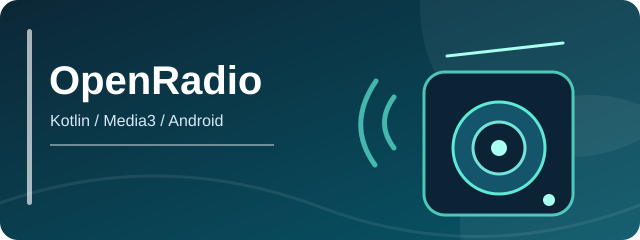
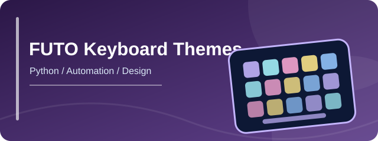

  

<h1 align="center">Hola, soy Latan Villegas</h1>

  <strong>Android Developer · Full-Stack Builder · Automation</strong>

  Diseño y desarrollo productos móviles y web con foco en
  <strong>arquitectura mantenible, rendimiento y una UX cuidada</strong>.

  
  
  
  

  <a href="#-proyectos-destacados">Proyectos</a> ·
  <a href="#-stack-tecnológico">Stack</a> ·
  <a href="#-cómo-trabajo">Enfoque</a> ·
  <a href="#-contacto">Contacto</a>

---

## ✨ Sobre mí

Construyo aplicaciones Android, experiencias web y herramientas de automatización que resuelven problemas reales. Busco un equilibrio entre **calidad técnica**, **experiencia de usuario** y **facilidad de mantenimiento**.

Mis repositorios muestran trabajo práctico con streaming, interfaces multiplataforma, personalización de Android y procesos automatizados.

## 🚀 Proyectos destacados

<table>
  <tr>
    <td width="50%" valign="top">
      
      <h3>📻 <a href="https://github.com/latanvillegas/Radio-Escucha">OpenRadio</a></h3>
      
<code>Kotlin</code> <code>Jetpack Compose</code> <code>Media3</code>

      
Radio por Internet para Android con reproducción en segundo plano, favoritos, historial y controles multimedia.

      
<a href="https://github.com/latanvillegas/Radio-Escucha">Código fuente</a> · <a href="https://github.com/latanvillegas/Radio-Escucha/releases/latest">Descargar APK</a>

    </td>
    <td width="50%" valign="top">
      
      <h3>🌐 <a href="https://github.com/latanvillegas/Radio_Satelital">Radio Satelital</a></h3>
      
<code>Next.js</code> <code>React</code> <code>TypeScript</code> <code>PWA</code>

      
Plataforma de emisoras en vivo con interfaz adaptable, experiencia PWA y herramientas de cabina de estudio.

      
<a href="https://github.com/latanvillegas/Radio_Satelital">Código fuente</a> · <a href="https://latanvillegas.online/">Abrir plataforma</a>

    </td>
  </tr>
  <tr>
    <td width="50%" valign="top">
      
      <h3>⌨️ <a href="https://github.com/latanvillegas/futo-keyboard-themes">FUTO Keyboard Themes</a></h3>
      
<code>Python</code> <code>GitHub Actions</code> <code>Packaging</code>

      
Temas personalizados para FUTO Keyboard con generación automatizada de paquetes y distribución mediante releases.

      
<a href="https://github.com/latanvillegas/futo-keyboard-themes">Código fuente</a> · <a href="https://github.com/latanvillegas/futo-keyboard-themes/releases/latest">Descargar temas</a>

    </td>
    <td width="50%" valign="top">
      
      <h3>📖 <a href="https://github.com/latanvillegas/biblia-viva">Biblia Viva</a></h3>
      
<code>React Native</code> <code>Expo</code> <code>TypeScript</code>

      
Aplicación de lectura y estudio bíblico para dispositivos móviles. <strong>MVP en desarrollo</strong>.

      
<a href="https://github.com/latanvillegas/biblia-viva">Explorar el proyecto</a>

    </td>
  </tr>
</table>

Las imágenes anteriores son ilustraciones de los proyectos, no capturas de sus interfaces. Funcionalidades y versiones: consultar cada repositorio.

## 🛠 Stack tecnológico

**Android / Mobile**

  
  
  

**Web / Multiplataforma**

  
  
  
  

**Automatización / Tooling**

  
  
  

## 🎯 Cómo trabajo

| Principio | Aplicación |
| --- | --- |
| **Arquitectura** | Separación de responsabilidades y evolución sostenible del código |
| **Performance** | Interfaces fluidas, carga controlada de recursos y mediciones verificables |
| **Calidad** | Integración continua, pruebas y documentación reproducible |
| **Experiencia** | Accesibilidad, claridad visual y atención a los detalles |

## 📫 Contacto

  <a href="mailto:alv.oficial123@gmail.com"><strong>✉️ Email</strong></a> &nbsp;·&nbsp;
  <a href="https://github.com/latanvillegas"><strong>GitHub</strong></a> &nbsp;·&nbsp;
  <a href="https://youtube.com/channel/UCn6V2K-aCDw_defqIb0OC1A"><strong>Proyecto musical morac</strong></a>

---

Construyendo software útil, limpio y con intención. · Perfil diseñado para ser visual, verificable y mantenible.

